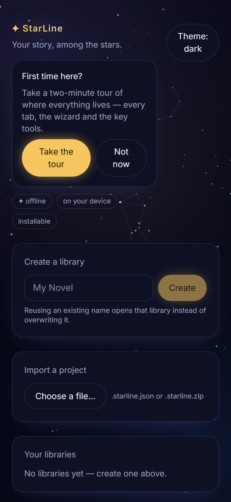
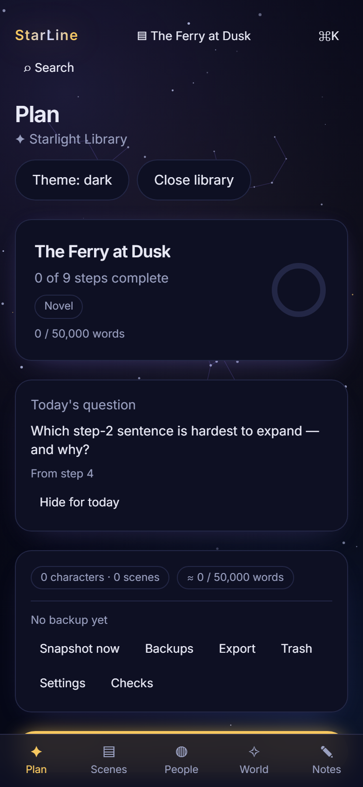
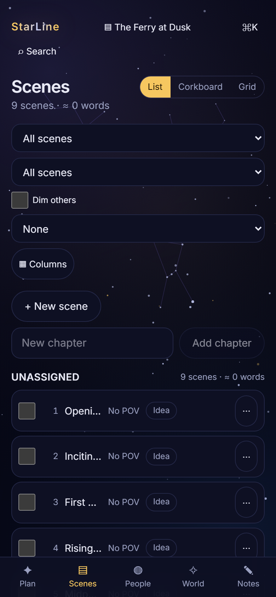

# StarLine

**Your story, among the stars.** A phone-first, offline novel-planning and writing
workstation: walk a single sentence through Randy Ingermanson's nine-step **Snowflake
Method** into a scene-by-scene outline, then keep characters, relationships, lore, timeline
and notes cross-linked while you draft. Everything lives on **your** device in a single
SQLite library file (`*.starline`). No accounts, no telemetry, no network.

[](https://github.com/daniilperkin/starline/actions/workflows/ci.yml)
[](LICENSE)
[](https://daniilperkin.github.io/starline/)

| Start | Plan | Scenes |
|---|---|---|
|  |  |  |

## Highlights

- **The Snowflake wizard, steps 1–9** — validators, character-to-scene extraction, soft
  gating: jump between steps freely, only `error`-severity issues block completion.
- **A connected world** — character dossiers, a relationship matrix and graph, a lore wiki
  with kinds and templates, `@`-mentions with backlinks, a timeline, tags and custom fields.
- **The outliner** — list and corkboard views, a plotline grid, multi-select bulk edits,
  saved filters, drag ordering.
- **Writing mode** — distraction-free editor, focus mode, autosave, per-device typography.
- **Safety first** — snapshots with diff + restore (whole library or a single entity), undo,
  trash, and a WAL SQLite file you own and can copy anywhere.
- **Output that round-trips** — export Markdown folder, JSON, DOCX (manuscript and planning),
  HTML and CSV; import JSON, Markdown, DOCX, CSV and `.starline` files.
- **Three languages** — English, Ukrainian and German at full parity (a catalogue shape test
  makes partial translations impossible).
- **Offline-complete** — no network primitives in app source, enforced by a gate; an optional
  Google-Drive backup exists only in the explicitly built cloud flavour (`STARLINE_CLOUD=1`)
  and is off by default.
- **Accessible** — WCAG 2.2 AA audit harness with 61 scripted checks beyond axe: keyboard
  walks with a visible focus ring, 24 px targets, 320 px reflow, reduced motion.

## Install

- **PWA (easiest)** — open <https://daniilperkin.github.io/starline/> in Chrome on your
  phone → menu → **Install app**. Fully offline afterwards.
- **Android APK** — download `starline-release.apk` from the latest release and sideload it
  (signed with the StarLine release key, Android 7+). See `docs/ANDROID-RELEASE.md`.
- **Desktop** — a Tauri shell lives in `apps/web/src-tauri` as the later native path.

## Run from source

```bash
pnpm install
pnpm --filter @starline/web dev        # http://localhost:5183
pnpm ci:gates                          # the whole local suite, the same sequence CI runs
```

Node 22+, pnpm 11. The Android APK additionally needs JDK 21 and the Android SDK; the Rust
crates need a Rust toolchain (see `AGENTS.md`).

## Documentation

- [`docs/SPECIFICATION.md`](docs/SPECIFICATION.md) — the implementation-ready spec (v1.0.0)
- [`docs/DECISIONS.md`](docs/DECISIONS.md) — every owner decision and audit resolution, numbered
- [`docs/PLAN.md`](docs/PLAN.md) — the slice-by-slice build plan and what each shipped slice measured
- [`docs/DESIGN.md`](docs/DESIGN.md) — the visual identity and the token contract
- [`docs/ARCHITECTURE.md`](docs/ARCHITECTURE.md) · [`docs/ACCESSIBILITY.md`](docs/ACCESSIBILITY.md) ·
  [`docs/CLOUD-BACKUP.md`](docs/CLOUD-BACKUP.md) · [`docs/CLOUD-SETUP.md`](docs/CLOUD-SETUP.md) ·
  [`docs/ANDROID-RELEASE.md`](docs/ANDROID-RELEASE.md) · [`docs/HOSTING.md`](docs/HOSTING.md) ·
  [`docs/FABULA-PARITY.md`](docs/FABULA-PARITY.md) · [`docs/SPEC-GAP-AUDIT.md`](docs/SPEC-GAP-AUDIT.md)
- [`AGENTS.md`](AGENTS.md) — the working guide for contributors and agents

## Status

**v1.0.1** — all planned milestones shipped (M0–M5, slices 1–38): foundation, planning core,
the connected world, safety & output, polish. The gates are green: typecheck, lint, 356 tests
across both storage drivers, kill-9 chaos (native and web), bundle budgets, the no-network
invariant, contrast pins, the full web journey, the PWA offline reopen, the accessibility
harness and the scripted device QA (53 checks, on the emulator and on a real Redmi 14C).

## Licence

[Mozilla Public License 2.0](LICENSE). The Snowflake Method is Randy Ingermanson's; StarLine
is an independent writing tool built on it.
